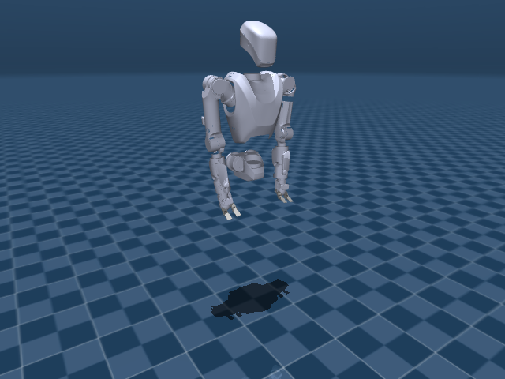
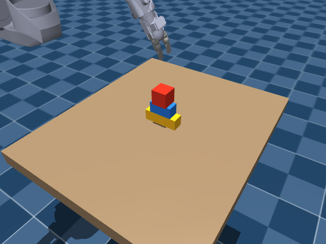

# Lightweight Brick Assembly VLA

**Research software for vision-language-action learning on the Alex robot.**

[](https://github.com/PatrizioAcquadro/VLA-LEGO_Project/actions/workflows/ci-cd.yml) [](pyproject.toml) [](LICENSE)

[Documentation](knowledge/wiki/index.md) · [Project status](knowledge/wiki/status.md) · [Implementation plans](knowledge/wiki/implementation_phases/index.md) · [Validation](knowledge/wiki/validation.md)

The goal is to teach Alex to pick up lightweight, variable-size bricks and arrange them into structures. The repository combines a MuJoCo environment, robot and camera interfaces, and a Qwen3.5-4B backbone with a flow-matching action head.

**Current stage:** simulation and model components are implemented and locally validated. Real demonstration collection, integrated training and a learned assembly policy remain planned. See [status and open questions](knowledge/wiki/status.md) for the current development boundary.

| Alex in MuJoCo | Lightweight-brick tower |
|:---:|:---:|
|  |  |

*Actual frames from `vla-demo`. The tower is initialized in its target layout for a physics diagnostic; it is not assembled by the robot.*

## What is included

| Component | Maintained capabilities |
|---|---|
| **Simulation** | Alex upper body, two EZGrippers, configurable bricks, seeded resets, tower and planar triangle goals, support and stability evaluation. |
| **Robot interfaces** | 17-D actions, 52-D state and four synchronized camera views. See the [contracts](knowledge/wiki/contracts.md). |
| **Model components** | Qwen3.5-4B processing, state/action projectors, flow matching and 16-step action chunks. See [models and limitations](knowledge/wiki/models.md). |
| **Development tools** | Diagnostic CLIs, packaged assets/configuration, subsystem tests, installed-wheel checks, containers and GitHub Actions. |

Here, “bricks” means lightweight pieces intended for physical prototyping, including 3D printing. Simulation currently uses cuboids; printed geometry and contact properties still need calibration. Real LEGO connections are a [future extension](knowledge/wiki/implementation_phases/phase-8-transfer-handoff.md#future-extension-real-lego). The repository and package names, `VLA-LEGO_Project` and `vla-lego`, are retained for continuity.

## Quick start

Use **Python 3.10+**. The headless example below targets **Linux with an NVIDIA GPU and EGL**. See [development setup](knowledge/wiki/development.md) for dependency groups and [simulation workflows](knowledge/wiki/simulation.md) for viewer and rendering options.

```bash
git clone https://github.com/PatrizioAcquadro/VLA-LEGO_Project.git
cd VLA-LEGO_Project

python3 -m venv .venv
source .venv/bin/activate
python -m pip install --upgrade pip
python -m pip install -e '.[sim]'

vla-lint-assets
MUJOCO_GL=egl vla-demo --scenario all --output-dir outputs/demo-001
```

The demo writes short MP4 clips, PNG frames and `report.json` for scripted robot motion and prearranged brick goals. Use a new output directory for each run. It does not download model weights or execute model predictions.

For native model checks, install the `vlm` extra and follow the [CUDA model validation workflow](knowledge/wiki/models.md#validate-and-profile). No trained brick-action checkpoint is included.

## Develop and validate

With the environment above activated:

```bash
python -m pip install -e '.[dev]'
make check                  # Lint, formatting, typing, docs and configuration
MUJOCO_GL=egl make test      # Full suite, including native GPU model checks
make package                # Build and verify an installed wheel
```

The full suite needs CUDA, VLM dependencies and pretrained weights for its native model tests. GPU-less CI uses an explicit CPU/OSMesa path. Report skipped tests separately from passed checks. [Validation evidence](knowledge/wiki/validation.md) records tested configurations, results and outstanding qualification work.

Keep changes focused, preserve the public contracts and add tests for maintained behavior or meaningful regressions. Contribution practices and container/cluster instructions live in [development](knowledge/wiki/development.md) and [operations](knowledge/wiki/cluster.md).

## Repository structure

```text
src/vla_lego/
├── sim/                MuJoCo, robot control, cameras, bricks and assets
├── models/             Qwen backbone, action head and losses
├── tracking/           Experiment metrics and optional W&B integration
└── configs/            Packaged Hydra configuration
tests/                  Simulation, model, tracking and package regressions
scripts/                Diagnostics and development utilities
infra/                  Containers and Gilbreth scheduler setup
knowledge/              Canonical guides, plans and presentation media
.github/workflows/      Automated checks and gated publication
```

Install the package before running scripts or tests. Runtime imports use the single `vla_lego` namespace; configuration and simulation assets ship with the package. See [architecture](knowledge/wiki/architecture.md) for module ownership and execution boundaries.

## Development roadmap

The [nine phase plans, 0–8](knowledge/wiki/implementation_phases/index.md), cover all 22 original subphases, completed components and remaining work. The next milestones are:

1. Calibrate a printable brick set and demonstrate a robot pick-and-place episode.
2. Collect a bounded pilot dataset, then add grounded annotations and temporal interleaving.
3. Integrate losses and single-GPU training/resume before qualifying distributed training.
4. Evaluate learned assembly, adaptation and physical transfer against explicit task criteria.

The phase plans define completion gates and dependencies. The [data specification](knowledge/wiki/data.md) defines the planned dataset; the [decision log](knowledge/wiki/log.md) records consequential scope changes.

## License and attribution

Project code is available under the [MIT license](LICENSE). Robot asset sources, upstream terms and modifications are documented in [asset provenance](src/vla_lego/sim/assets/robots/alex/PROVENANCE.md). Pretrained models retain their upstream licenses; model and research sources are listed in [references](knowledge/wiki/references.md).

For reproducible bugs or scoped proposals, [open an issue](https://github.com/PatrizioAcquadro/VLA-LEGO_Project/issues) with the relevant command, environment and observed behavior.
