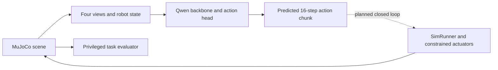

# Architecture

## Maintained components

| Owner | Responsibility | Active consumers |
|---|---|---|
| `sim/asset_loader.py`, `sim/asset_linter.py` | Portable scene loading, include/mesh path validation | Viewer, simulation, installed-wheel check |
| `sim/action_space.py`, `control.py`, `end_effector.py` | Normalized commands, actuator limits, EZGripper interface | `SimRunner`, robot validators/tests |
| `sim/robot_state.py`, `sim_runner.py` | Named state extraction and fixed-rate stepping | Demo, model smoke, future collector |
| `sim/offscreen.py`, `camera.py` | RGB/depth/segmentation and synchronized camera metadata | Demo, native model smoke, future recorder |
| `sim/bricks/` | Brick catalog, generated scenes, reset and task evaluation | Brick CLI, demo, physical regression tests |
| `models/vlm_backbone.py` | Lazy pretrained loading, multimodal processing and hidden-state access | VLA, GPU smoke/profiler |
| `models/action_head.py`, `vla_model.py` | Projectors, flow-matching math and model assembly | Model smoke, meaningful component/GPU tests |
| `models/losses.py` | Explicit text/action loss and masking contracts | Loss tests; intended Phase 4.1 integration |
| `tracking/` | Experiment metadata, metrics, GPU monitoring and optional W&B adapter | Maintained integration library for Phase 4.2; no current trainer |
| `configs/` | Model composition, simulation/brick contracts and location metadata | Hydra, CLI/operator workflows, installed package |
| `scripts/`, `infra/gilbreth/` | Focused diagnostics, containers and scheduler templates | Developers/operators |
| `tests/`, `tools/` | Behavioral regression and installed-package checks | Local development and CI |

## Execution boundary

The model smoke connects real rendered observations to model outputs. It does not execute those untrained outputs on the robot. A learned closed-loop runner, dataset reader, trainer and task benchmark remain future work.

Simulator object poses/contact forces support reset, teacher development and evaluation. They must not silently enter policy observations or learned action selection. Keep teacher/evaluator data separate from the deployable [observation contract](contracts.md).

## Removed consumers

The random dataset, generic Transformer, synthetic trainer/evaluator and toy distributed jobs had no maintained task behavior. Their imports, CLIs, presets and exclusive tests were removed together. LEGO connection geometry, insertion assistance and hybrid retention were also retired from the active runtime. [History](history.md) preserves consequential outcomes and retrieval pointers.
