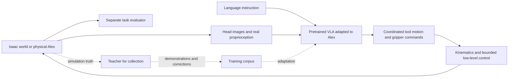

# Architecture

## Planned robot and ownership

The native foundation uses the shared [Alex asset repository](https://github.com/PatrizioAcquadro/purdue-alex-assets), available locally at `/home/pacquadr/Desktop/Alex`. Revision `9ac4bd4` provides `ihmc_alex_isaaclab`, including the fixed-base Purdue WSG32/UMI profile, pedestal and head ZED integration. Its documented target is Isaac Sim 6.0.1 / Isaac Lab release/3.0.0-beta2; [native integration and single-block reference evidence](foundations.md) are verified on Blackwell, while the complete cooperative task remains under development.

| Element | Design and boundary |
|---|---|
| Embodiment | Fixed-base Purdue Alex003 on the measured pedestal, both arms active; no locomotion task. |
| End-effectors | Two WSG32-068 with UMI v1 fingers. Shared assets are simulation-ready; physical commands, feedback and stopping must be established early. |
| Sensing | Head ZED X Mini RGB baseline with real proprioception and language. Additional stereo/depth use requires a declared deployable input; wrist cameras require demonstrated occlusion benefit. |
| Onboard compute | Jetson AGX Orin for VLA inference, sensing and communication; the robot's NUC retains low-level control duties. |
| Shared Alex repository | Reusable robot/gripper/sensor/pedestal assets, default configuration, frames and physical reference measurements. |
| This project | Task scene, calibration, control adapter, teachers, data, learning, qualification and deployment integration. |

The [Alex usage guide](https://docs.google.com/document/d/17QtexPK_RqmfRammA7CsvEUuhFZFkicrJfONCdlWkEg/edit?tab=t.sfoy44dcf7kc) describes the Orin/NUC and robot-control setup. It documents SAKE/Ability hand support, which does not establish WSG32 command integration. The local AlexDoor-XAS and SquadBot projects already consume the WSG32/head-ZED setup: reuse established frame/sensor handling, without importing their task logic. Physical configuration still governs this project's calibration.

## Planned execution boundary

The VLA chooses pieces, sequence, arm roles and corrective behavior. The controller handles motion realization, limits, stale commands and stopping; it does not secretly solve the assembly task. Privileged teacher inputs and evaluator truth never become undeclared policy inputs. Teacher-assisted collection and autonomous qualification are separate execution modes.

Online learned perception/planning used by the policy runs on Orin, including any learned auxiliary module; the NUC keeps the established low-level robot functions. Offboard compute is for development, training, offline teachers or passive recording/evaluation, not a hidden online task planner. Human scene preparation between episodes is permitted; autonomous resetting of loose pieces is outside the current completion requirement.

Camera capture, model replanning and actuator command rates are separate. The chosen observation/action representation and timing are defined in [contracts](contracts.md); model and onboard constraints in [models](models.md).

## Existing implementation and migration

The current `src/vla_lego` package contains MuJoCo scene loading/control/cameras/bricks, Qwen and flow-matching components, standalone losses, optional tracking and packaged configuration. Repository utilities and scheduler/container templates are separate from the distributable runtime. See [development](development.md) for the actual layout and [simulation](simulation.md) for working diagnostics.

Existing model smoke connects rendered observations to untrained predictions without executing them. There is no collector, trainer or learned closed loop. Existing package and behavioral evidence applies only to that path.

[Phase 0](implementation_phases/phase-0-foundation.md) establishes ownership and staged retirement; [Phase 8](implementation_phases/phase-8-consolidation.md) completes it. Preserve [legacy robot provenance](../../src/vla_lego/sim/assets/robots/alex/PROVENANCE.md) until those assets and their consumers retire, retaining attribution for any reused content. Do not duplicate shared Alex assets to create another authority.
